# Network Monitor (TCP/HTTP)

Keep an eye on your network from your AWTRIX NG clock. NetworkMonitor checks TCP services and HTTP endpoints, shows your public IP address, and cycles through a network overview, active failures, and per-host response history.

**Platform:** Ulanzi TC002 · **Display:** 52 × 16 · **Version:** 0.27

**Authors:** Dr-Dream / ChatGPT / Codex

**GitHub:** [Dr-Dream/AwtrixNetworkMonitor](https://github.com/Dr-Dream/AwtrixNetworkMonitor)

**AWTRIX Hub:** [Install NetworkMonitor](https://awtrix.de/script/eTYy7Bu4YsbA)

## Features

- Separate, comma-separated lists for TCP services and HTTP/HTTPS URLs.
- Public IPv4/IPv6 address retrieval through `http://ifconfig.me` by default.
- Three pages: HOME, ALERTS, and NODES.
- Colored results, failure reasons, response times, and a rolling history graph.
- Automatic page rotation or manual navigation with the knob.
- Optional animated instance icons: house, VPN shield, server, WiFi, database, and cloud.
- Configurable colors, intervals, timeouts, scrolling, and page timing.
- Background checks continue while another app is displayed. No external icon downloads are required.

## Screens

The diagrams below explain the layout; they are not exact pixel or font reproductions. Long labels scroll inside their own text area. Page names such as HOME are documentation labels, not additional titles drawn on the clock.

### HOME — network overview

```text
+--------------------------------------------------+
| [house]  203.0.113.42                             |
|          8 / 1 / 2                               |
+--------------------------------------------------+
           OK  FAIL WAIT
```

The upper line shows the public IP address beside the small HOME pictogram. The lower line shows counts of successful, failed, and pending TCP/HTTP targets, in that order. Public IP status is separate from these counts.

- Before the first valid IP: `...`, or `!` after a failed request.
- After a failed refresh: the last valid address followed by `!`.
- While refreshing a known address: the address followed by `...`.

The lower counters use the full available interface width; their indentation above only makes the diagram easier to read.

### ALERTS — what needs attention

```text
+--------------------------------------------------+
| [alert]  https://example.com/health                |
|   [X]    HTTP 503  1/2                            |
+--------------------------------------------------+
```

Only failed targets appear here. The first line shows the target; the second shows the failure reason and its position in the failure list. The upper pictogram and lower cross identify an alert; the cross pulses. The page is skipped when there are no failed targets.

Examples of failure reasons include `HTTP 503`, `Network error`, `timeout`, `refused`, and `dns`; TCP reason strings come from the firmware.

### NODES — individual targets and history

```text
+--------------------------------------------------+
| [TCP]  example.com:443  42ms                      |
|        .  : . | :  . : | .                       |
+--------------------------------------------------+
         older --------------------------> newer
```

The upper line shows a small TCP or HTTP pictogram, the target, and its result in one scrolling line. A successful result is a time in milliseconds; `ERR` means failure, and `--` means no completed result yet. A trailing `...` marks a check in progress while the last completed result remains visible.

The graph fills the lower half of the available interface area:

- One completed check occupies one pixel column.
- Successful bars use a green-to-orange vertical gradient relative to the minimum successful response time in each node’s retained history. Stable values stay green; small fluctuations receive a slight tint, and substantial increases move toward orange. Falling values become greener again. **Full orange increase** (100% by default) sets the minimum relative growth needed to reach orange; when the observed range is larger, its maximum becomes the orange endpoint. Bar heights scale to the largest successful response time in the retained history.
- Failed checks are full-height red bars.
- Oldest samples appear on the left; newest samples appear on the right. Once full, the graph drops the oldest sample.
- With no samples, a dim baseline is shown. With no configured targets, the page displays `--` and `0 targets`.

The graph is drawn directly below the header across the full available width; the sketch uses punctuation only to suggest bars.

### Optional instance icon

Use different icons and colors to distinguish multiple installed copies, such as home, office, and VPN monitoring.

```text
+--------------+-----------------------------------+
|              | [page]  target or public IP        |
|   INSTANCE   |                                   |
|     ICON     | counters, failure reason or graph  |
|              |                                   |
+--------------+-----------------------------------+
```

The large icon stays on the left on every page. All original page/protocol pictograms remain visible to its right. On TC002, the default icon area is 14 × 14 pixels, with a one-pixel left margin, a one-pixel gap before the interface, and vertical centering. Disabling the icon restores the original full-width layout.

Available choices: `home`, `shield` (VPN), `server`, `wifi`, `database`, and `cloud`. These identify the script instance; choosing a shield does not add a VPN check.

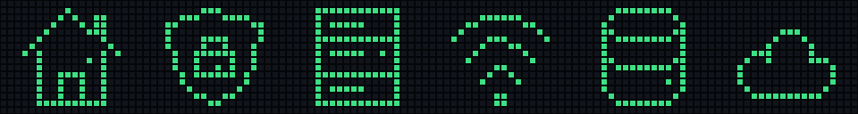

## Controls and page rotation

| Control / mode | Behavior |
| --- | --- |
| Middle/select button | Requests a new node scan and public IP refresh after the current operation finishes. |
| `auto` mode | HOME → ALERTS if needed → NODES if enabled → next app in the device rotation. |
| `manual` mode | Turn the knob left or right to change pages. Entries within a page still advance automatically. |

Each entry stays for at least **Minimum entry duration**. Long text gets time to scroll, bounded by **Scroll wait limit**. In automatic mode, NetworkMonitor holds the app rotation while it shows its entries. A long target list can therefore take considerably longer than one page duration.

## Quick setup

1. Install NetworkMonitor from AWTRIX Hub, or add the complete `NetworkMonitor.ax` source in the web interface's **Scripts** tab.
2. Open **Apps → your installed script → gear**.
3. Set **TCP hosts** and/or **HTTP URLs** independently. Both lists are empty by default.
4. Optionally enable an instance icon and choose its shape and color.
5. Save. The app restarts and begins collecting fresh results.

Example TCP hosts:

```text
192.168.1.1:80,example.com:443,nas.local:445
```

Example HTTP URLs:

```text
https://example.com/health,http://192.168.1.10:8080/status
```

Spaces around entries are allowed. TCP entries require an explicit port from 1 to 65535. HTTP entries require a complete `http://` or `https://` URL. Encode commas within URLs as `%2C`. Invalid entries are skipped and logged.

To monitor separate groups, install the source under different script names and configure each copy independently.

## Configuration

All settings are available in the app's gear menu. Defaults below apply to a new installation; updates preserve existing saved values. Saving settings restarts the app and clears collected results and history.

### Monitoring

| Setting | Default | Description |
| --- | --- | --- |
| **TCP hosts** (`tcphosts`) | Empty | Comma-separated `host:port` entries; maximum 256 characters. A successful connection means OK; it is closed immediately. |
| **HTTP URLs** (`httphosts`) | Empty | Comma-separated complete URLs; maximum 512 characters. Final HTTP status 200–299 means OK. Response content is not checked. |
| **Public IP URL** (`ipurl`) | `http://ifconfig.me` | Endpoint returning only an IPv4/IPv6 address, with optional surrounding whitespace; maximum 256 characters. |
| **Check interval** (`interval`) | 60 s | Delay after a complete node scan finishes; 30–600 s. |
| **Public IP refresh** (`wanperiod`) | 300 s | Delay after a public IP request completes; 60–3600 s. |
| **TCP timeout** (`tcp_timeout`) | 4 s | Connection timeout; 1–30 s. |
| **HTTP timeout** (`http_timeout`) | 5 s | HTTP request timeout; 1–30 s. Firmware queueing and DNS have additional limits. |
| **Show NODES page** (`show_nodes`) | On | Include per-target results and history in the page sequence. |

### Display

| Setting | Default | Description |
| --- | --- | --- |
| **Page mode** (`mode`) | `auto` | `auto` or `manual`; see controls above. |
| **Minimum entry duration** (`pagetime`) | 5 s | Minimum time for HOME or one target entry, not an entire target list; 2–30 s. |
| **Scroll wait limit** (`scrollwait`) | 60 s | Maximum wait per entry; 10–180 s. The effective limit is at least the minimum entry duration. |
| **Graph gradient** (`graph_gradient`) | On | Green-to-orange vertical gradient for successful history bars. Off uses a solid Success color. |
| **Full orange increase** (`graph_full_pct`) | 100% | Minimum increase above the retained successful minimum needed for full orange; 10–1000%. Larger values soften the color change. |
| **Scroll speed** (`scrollspeed`) | 65% | Scrolling speed; 10–300%. Firmware base speed at 100% is 21 pixels/s. |
| **Scroll gap** (`scrollgap`) | 10 px | Gap between scrolling repeats; 0–100 px. |
| **Scroll start delay** (`scrollhold`) | 500 ms | Pause before scrolling begins; 0–5000 ms. |
| **Hold after knob input** (`manualhold`) | 20 s | Hold after the last manual knob turn; 10–180 s. When it expires, the device advances to the next app. |
| **Manual display duration** (`manualtime`) | 30 s | Normal app dwell time in manual mode before knob interaction; 5–180 s. |

### Icon

| Setting | Default | Description |
| --- | --- | --- |
| **Show instance icon** (`show_icon`) | Off | Add the large identifier to the left of every page. |
| **Instance icon** (`icon_kind`) | `home` | `home`, `shield`, `server`, `wifi`, `database`, or `cloud`. |
| **Icon color** (`icon_color`) | `#40B8E0` | Independent of check status and the smaller pictogram colors. |
| **Animate icon** (`icon_animate`) | On | Animate icon details; WiFi pulses wave brightness and the cloud moves gently. Off keeps a static symbol. |
| **Icon left margin** (`icon_left`) | 1 px | Blank space before the large icon; 1–4 px. |
| **Icon inset** (`icon_inset`) | 1 px | Vertical inset on each edge; 0–2 px. TC002 sizes: 16 × 16 at 0, 14 × 14 at 1, 12 × 12 at 2. |
| **Animation frame duration** (`icon_step`) | 350 ms | Duration of one of four animation phases; 100–2000 ms. |

The history capacity follows the remaining interface width: 52 samples per target without an instance icon, or 36 with default icon settings. Changing margins or icon size also changes that capacity.

### Colors

| Setting | Default | Used for |
| --- | --- | --- |
| **Slow graph color** (`color_graph_top`) | `#FF9830` | Gradient color at and above Orange response time. The low-latency endpoint uses Success. |
| **Success** (`color_ok`) | `#40D080` | Successful results, active OK count, and successful history bars. |
| **Failure** (`color_fail`) | `#FF4040` | Failed results, alerts, active failure count, and failed history bars. |
| **Pending** (`color_wait`) | `#FFD040` | Pending results and active pending count. |
| **TCP icon and activity** (`color_info`) | `#40B8E0` | TCP pictogram, activity indicator, and public IP refresh state. |
| **HTTP icon** (`color_http`) | `#B080FF` | HTTP pictogram on NODES. |
| **Text** (`color_text`) | `#FFFFFF` | Normal target text, public IP text, and counter separators. |
| **Inactive status** (`color_dim`) | `#888888` | Zero counters and inactive status. |
| **Failure reason** (`color_reason`) | `#FF8040` | Failure details on ALERTS. |
| **Empty history** (`color_empty`) | `#404040` | Baseline before a target has history samples. |

## Compatibility and check behavior

NetworkMonitor requires **AWTRIX NG on TC002**, including the `tcp` scripting capability. It does not target AWTRIX 3 or ESP32-based TC001 firmware.

TCP checks test whether a connection can be established. HTTP checks test the final HTTP status and follow redirects according to firmware rules. Displayed times include request processing and queueing; they are not ICMP ping measurements. Checks run sequentially, with no automatic retries within a scan. Public IP retrieval is separate from node status and takes priority when due.

No API key or external icon pack is required. Do not include passwords or tokens in monitored URLs: URLs appear on screen and in logs.

Version 0.27 was compiled and run on TC002 with AWTRIX NG 1.2.3. All six instance icons were checked through the device framebuffer. This verification does not cover every network failure mode or firmware version.

Complete source: [NetworkMonitor.ax](NetworkMonitor.ax). Implementation details: [architecture](docs/architecture.md).

## Screenshots and animation

[Downloadable PNG screenshots and animated GIF](docs/media/README.md) show real device captures made with temporary demonstration hosts. The original host configuration was restored after recording.

Screenshots and animation use a visible LED grid with dark gaps between pixels, preserving the captured pixel layout and lit colors.

### HOME

| Without instance icon | With instance icon |
| --- | --- |
| 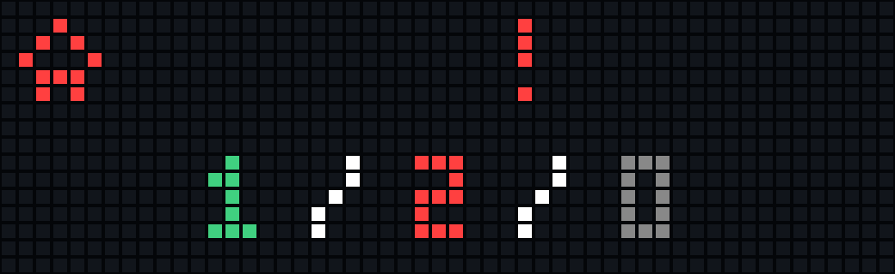 | 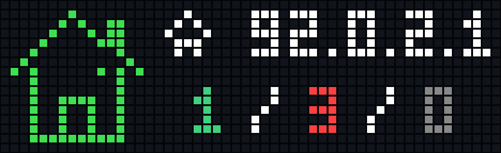 |

### ALERTS

| Without instance icon | With instance icon |
| --- | --- |
| 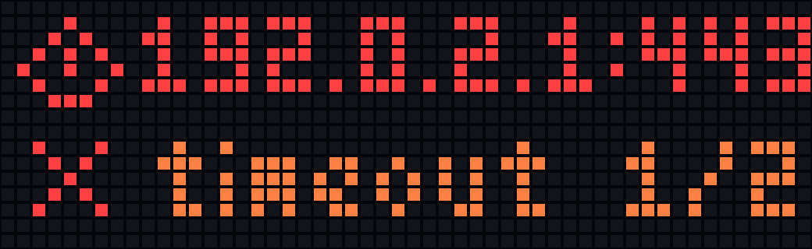 | 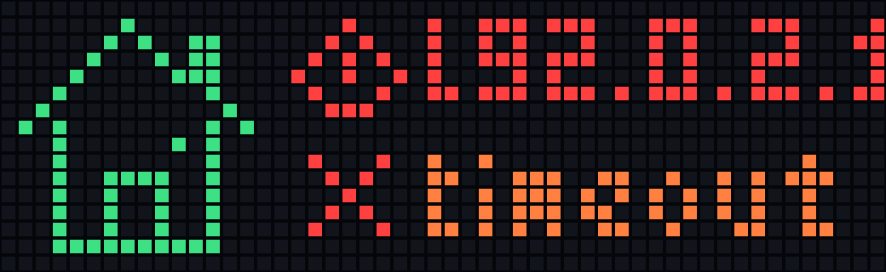 |

### NODES — TCP

| Without instance icon | With instance icon |
| --- | --- |
| 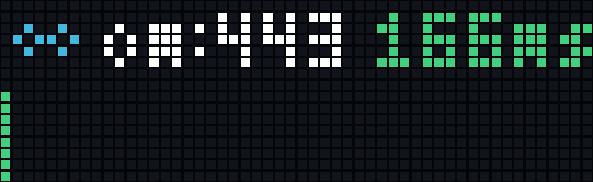 | 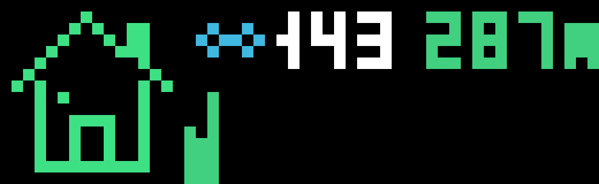 |

### NODES — HTTP

| Without instance icon | With instance icon |
| --- | --- |
| 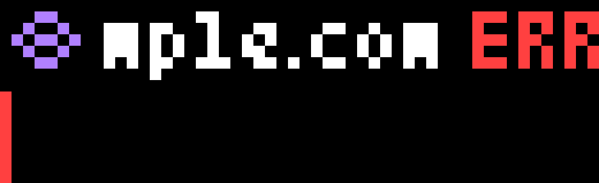 | 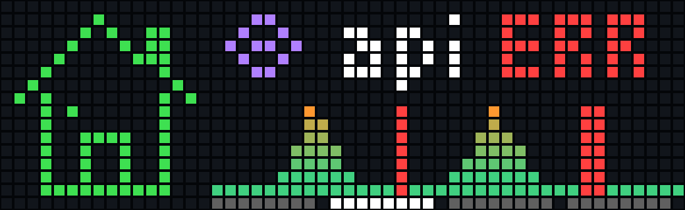 |

### AWTRIX Hub cover

A staged demonstration of HOME and a populated history graph, rendered on the device using synthetic data.

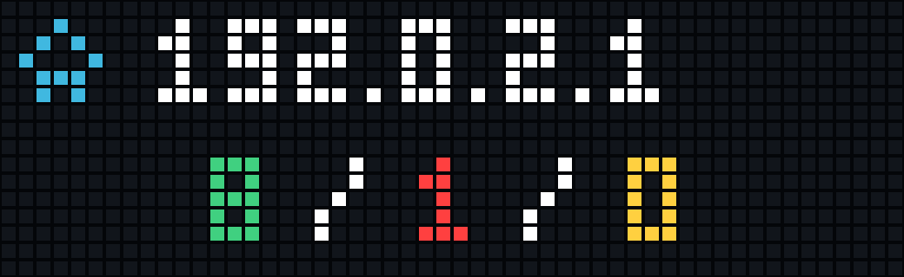

### Animated demonstration

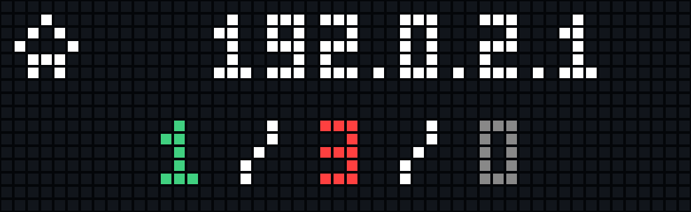
