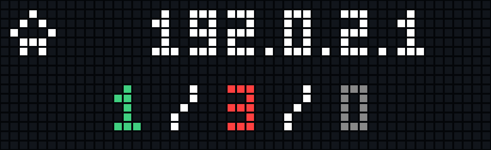

# AWTRIX Hub media

These images were captured from the real 52×16 TC002 framebuffer running NetworkMonitor 0.27. Screenshots are rendered at **1040×320** with a visible LED matrix: each source pixel occupies a 20×20 cell with a 16×16 LED face and dark gaps. Unlit cells use a dim neutral face so the grid remains visible. Lit-pixel colors and positions are preserved, without smoothing, added labels, or fabricated results. The same presentation is applied to the GIF.

## Files

| Page | Full-width layout | With instance icon |
| --- | --- | --- |
| HOME | [home.png](home.png) | [home-with-icon.png](home-with-icon.png) |
| ALERTS | [alerts.png](alerts.png) | [alerts-with-icon.png](alerts-with-icon.png) |
| NODES / TCP | [nodes-tcp.png](nodes-tcp.png) | [nodes-tcp-with-icon.png](nodes-tcp-with-icon.png) |
| NODES / HTTP | [nodes-http.png](nodes-http.png) | [nodes-http-with-icon.png](nodes-http-with-icon.png) |

[networkmonitor-demo.gif](networkmonitor-demo.gif) is a looping **26-second**, **5 fps**, **1040×320** animation showing HOME, ALERTS, TCP history, and HTTP results. It combines short recordings of these pages; scene changes are editorial cuts, while text movement within each scene comes from the device. Short page recordings hold their last frame until the next scene.

## Capture setup

The user's actual hosts were temporarily replaced with `example.com` and the documentation-only address `192.0.2.1`. Public IP requests were redirected away from the real-IP service. The second series attempted to retrieve the documentation address `203.0.113.42` from a static-response endpoint, but that request failed on the device; HOME therefore honestly shows the unavailable-IP marker (`!`). No actual public IP appears in these images.

TCP/HTTP results and short histories are real observations of the temporary capture setup. Some HTTP requests failed; failure labels and graph bars have not been retouched. A full history takes multiple scans to accumulate, so the graphs are intentionally sparse.

All original configuration values were restored and compared with the pre-capture backup after recording. No original hostnames, credentials, configuration backups, or raw capture logs are included in this directory.
